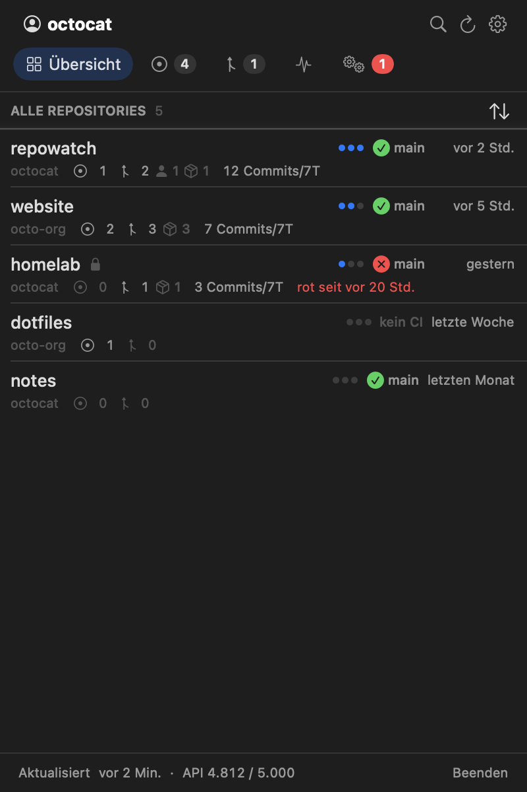
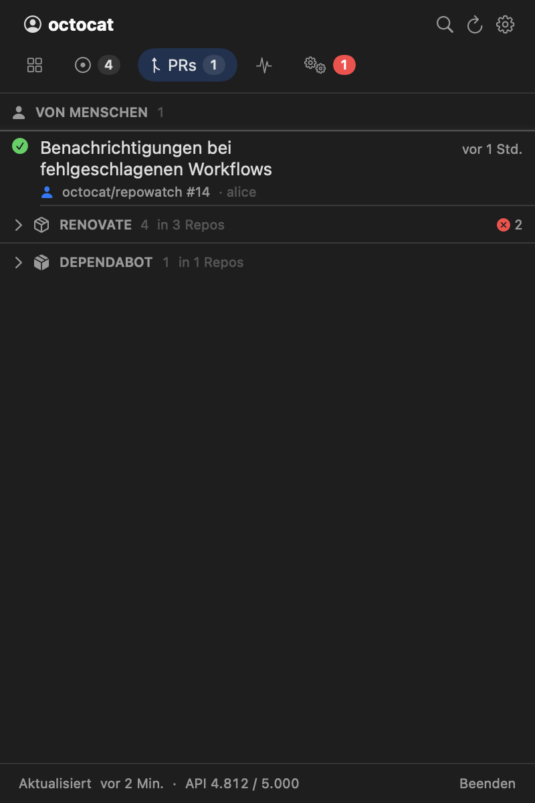
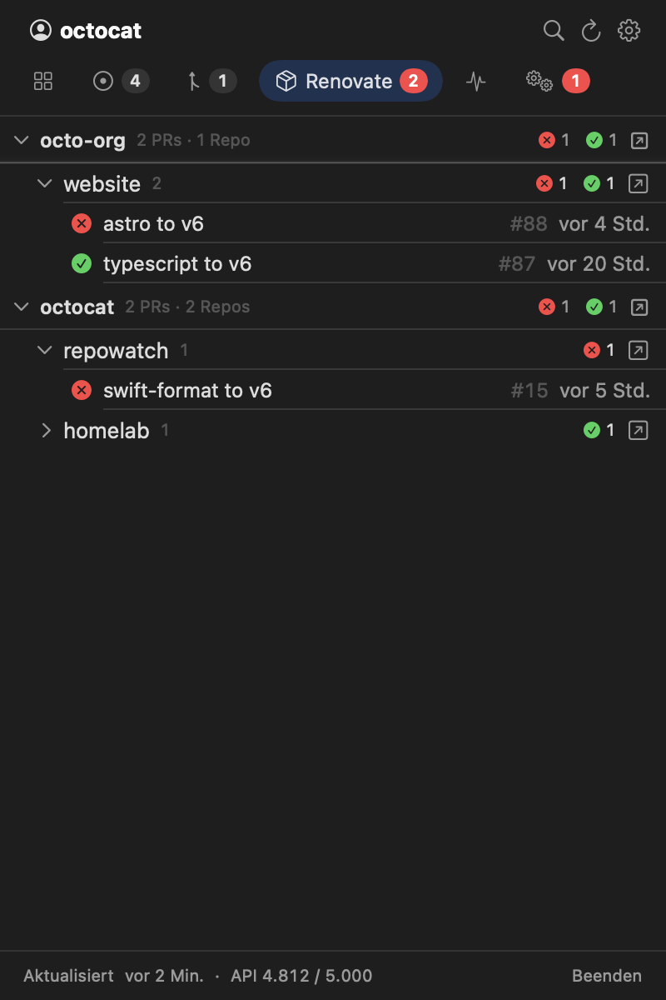
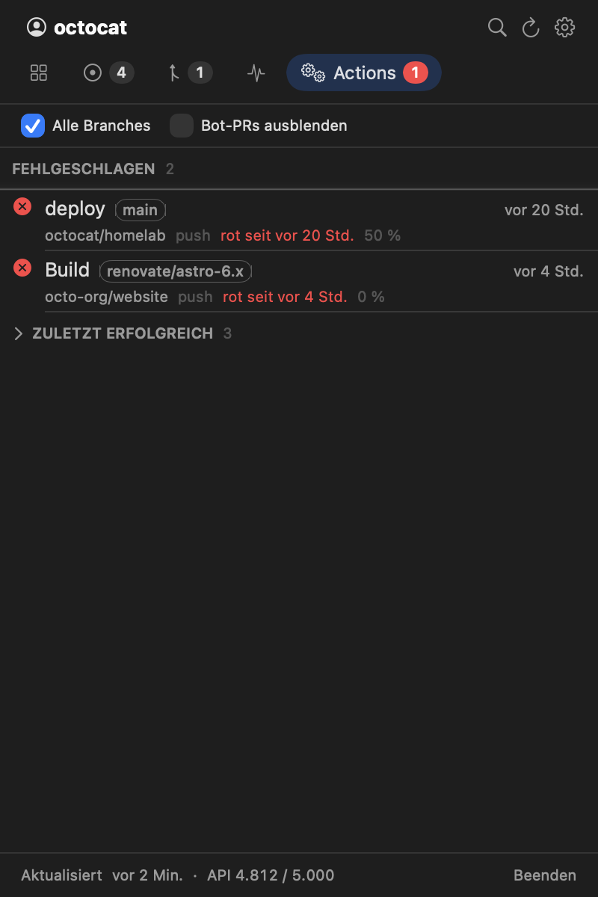
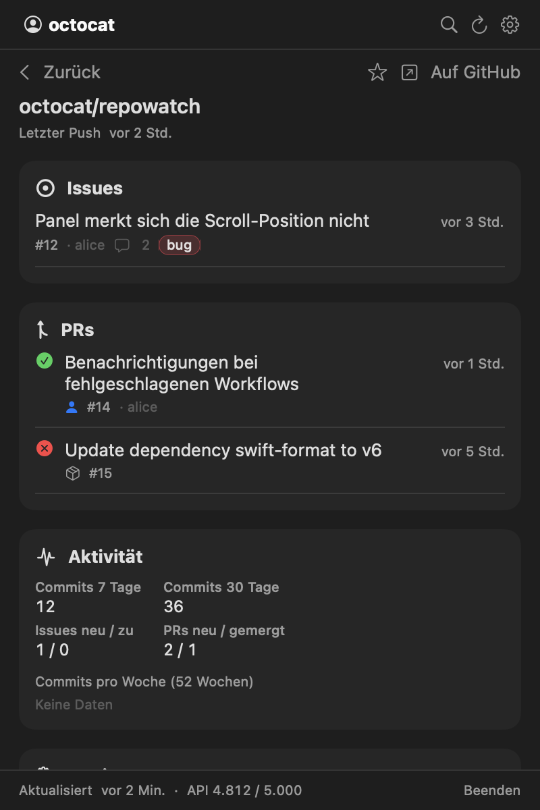

# RepoWatch

Eine kleine, native Menüleisten-App für macOS, die alle GitHub-Repositories im Blick behält, auf die
dein Account Zugriff hat: offene Issues, Pull Requests nach Autor, Aktivität und GitHub-Actions-Runs.

| Übersicht | Pull Requests | Renovate | Actions | Details |
|---|---|---|---|---|
|  |  |  |  |  |

*(Screenshots mit Demo-Daten.)*

## Funktionen

- **Issues** aller Repos mit Labels und Filter nach Repo und Label. Bot-Issues wie Renovates
  „Dependency Dashboard“ lassen sich ausblenden.
- **Pull Requests** nach Autor gruppiert: von Menschen, von dir, Renovate, Dependabot, andere Bots.
  Bot-Gruppen sind eingeklappt, rote Checks auf einen Blick.
- **Renovate:** eigener Reiter mit allen Renovate-PRs, gegliedert nach Org → Repo → PR, mit
  CI-Status (✗/✓/ausstehend) und Links auf die gefilterte PR-Liste je Repo und je Org. Rote
  Checks stehen oben und sind aufgeklappt.
- **Aktivität:** Commits der letzten 7/30 Tage, neue und geschlossene Issues und PRs, eine
  Aktivitätsstufe relativ zu deinen Repos, Wochen-Grafik und Ereignis-Feed.
- **GitHub Actions:** Status des Standard-Branches, fehlgeschlagene Workflows mit „rot seit …“,
  Fehlschläge in Folge und Erfolgsquote, laufende Runs.
- **Menüleiste:** wahlweise mit Zähler oder Punkt bei Neuem; ein roter Punkt, wenn der
  Standard-Branch oder ein PR eines Menschen rot ist (Bot-PRs lösen keinen Alarm aus).
- **Sparsam mit der API:** gebündelte GraphQL-Abfragen, ETags für REST, aktive Repos alle 5 Minuten,
  ruhende alle 30 Minuten. Beim Start sind die zuletzt geladenen Daten sofort da.
- **Erweiterbar:** Jede Funktion ist ein Modul mit eigener Abfrage und eigener Oberfläche
  (siehe [Konzept](docs/01-konzept.md), Abschnitt 9).

## Voraussetzungen

macOS 26 oder neuer.

## Installation

1. Unter [Releases](https://github.com/pmoscode/RepoWatch/releases) das neueste `RepoWatch-x.y.z.dmg` laden.
2. DMG öffnen und RepoWatch in den Programme-Ordner ziehen.
3. RepoWatch starten. Das Fernglas erscheint in der Menüleiste.

Ist ein Release als **nicht notarisiert** gekennzeichnet, blockiert macOS den ersten Start. Dann mit
Rechtsklick → *Öffnen* starten, oder unter *Systemeinstellungen → Datenschutz & Sicherheit* auf
*Trotzdem öffnen* klicken.

Mit `shasum -a 256 RepoWatch-x.y.z.dmg` lässt sich der Download gegen die `.sha256`-Datei des Releases prüfen.

## Anmeldung

Beim ersten Öffnen fragt RepoWatch nach der Anmeldung:

- **Mit GitHub anmelden** (empfohlen): RepoWatch zeigt einen Code und öffnet GitHub. Code
  eingeben, bestätigen, fertig. Dabei wird der Zugriff `repo` und `read:org` erteilt. RepoWatch
  liest nur und ändert nichts.
- **Personal Access Token:** ein [fine-grained Token](https://github.com/settings/personal-access-tokens/new)
  mit Leserechten für *Metadata*, *Contents*, *Issues*, *Pull requests* und *Actions*.

**Organisationen mit OAuth-Beschränkung** müssen RepoWatch freigeben. Fehlen deshalb Repos, zeigt die
Übersicht einen Hinweis mit Link zur Freigabe.

## Datenschutz

- RepoWatch spricht ausschließlich mit `api.github.com` (bei der Anmeldung auch `github.com`).
  Es gibt keinen eigenen Server und keine Telemetrie.
- Das Token liegt im Schlüsselbund dieses Macs und wird nicht über iCloud synchronisiert.
- Der Cache mit Repo-Namen und Titeln liegt im Sandbox-Container der App. Beim Abmelden werden
  Token, Cache und „Gesehen“-Stand gelöscht.

## Entwicklung

Benötigt Xcode 27, [XcodeGen](https://github.com/yonaskolb/XcodeGen) und [Task](https://taskfile.dev):

```bash
brew install xcodegen go-task
```

RepoWatch für diesen Mac bauen, nach `/Applications` installieren und starten:

```bash
task install
```

Weitere Aufgaben (`task` listet alle):

| Aufgabe | Wirkung |
|---|---|
| `task build` | Release-Build nur für die Architektur dieses Macs, ad hoc signiert, nach `build/local/` |
| `task run` | wie `build`, startet die App direkt aus `build/local/` |
| `task install` | wie `build`, kopiert nach `/Applications` (anderer Ort: `task install INSTALL_DIR=~/Applications`) |
| `task demo` | Debug-Build mit Demo-Daten, ohne Token und ohne Netz |
| `task test` | Tests des Swift-Pakets (über 90, ohne Netz) |
| `task lint` | Workflows mit actionlint prüfen |
| `task release VERSION=0.1.0` | universelles DMG wie im Release-Workflow |
| `task generate` | nur das Xcode-Projekt erzeugen, danach `open RepoWatch.xcodeproj` |
| `task clean` | Build-Ordner und erzeugtes Projekt löschen |

Ein neu gebautes, ad hoc signiertes RepoWatch gilt für den Schlüsselbund als andere App. Beim ersten
Start nach dem Bauen fragt macOS deshalb, ob RepoWatch das gespeicherte Token lesen darf
(*Immer erlauben*).

Aufbau:

| Ordner | Inhalt |
|---|---|
| `App/` | App-Target: Menüleisten-Symbol, Panel, Einstellungsfenster, Verdrahtung |
| `Packages/RepoWatchKit/Sources/` | Alle Schichten als eigene Targets: `Domain`, `GitHubAPI`, `Auth`, `Persistence`, `ModuleKit`, `ModuleUIKit`, `Sync`, `DesignSystem`, die vier Module und `Features` (Panel, Einstellungen) |
| `docs/` | [Konzept](docs/01-konzept.md) und [Implementierungsplan](docs/02-implementierungsplan.md) |
| `scripts/build-release.sh` | Release-Build und DMG, signiert und notarisiert, wenn die Zugangsdaten gesetzt sind |
| `Taskfile.yml` | Aufgaben für Bauen, Installieren, Tests und Release |

Startparameter für Debug-Builds:

| Parameter | Wirkung |
|---|---|
| Umgebungsvariable `GITHUB_TOKEN` | Token statt Schlüsselbund, z. B. `open --env "GITHUB_TOKEN=$(gh auth token)" RepoWatch.app` |
| `--demo` | Demo-Daten ohne Token und ohne Netz |
| `--show-panel`, `--tab <issues\|prs\|renovate\|activity\|actions>`, `--repo <name>` | Panel direkt öffnen, Reiter bzw. Repo wählen |
| `--show-settings` | Einstellungsfenster öffnen |
| `--snapshot <name>` | nach 7 s ein PNG in den Sandbox-Container schreiben (`~/Library/Containers/de.pmoscode.repowatch/Data/tmp/`) |
| `--no-glass`, `--appearance light\|dark` | für Screenshots: ohne Glas-Ebene, festes Erscheinungsbild |

### Release

Ein Tag `vX.Y.Z` startet den Workflow [Release](.github/workflows/release.yml): Er führt die Tests
aus, baut ein universelles DMG (Apple Silicon und Intel) und hängt es mit Prüfsumme an ein
GitHub-Release.

```bash
git tag v0.1.0 && git push origin v0.1.0
```

Signiert und notarisiert wird nur, wenn diese Repository-Secrets gesetzt sind (Apple Developer Program nötig):

| Secret | Inhalt |
|---|---|
| `DEVELOPER_ID_CERT_P12` | Base64 des exportierten Zertifikats „Developer ID Application“ (`base64 -i cert.p12 \| pbcopy`) |
| `DEVELOPER_ID_CERT_PASSWORD` | Passwort der `.p12`-Datei |
| `DEVELOPER_ID_IDENTITY` | z. B. `Developer ID Application: Max Muster (ABCDE12345)` |
| `DEVELOPER_TEAM_ID` | Team-ID, z. B. `ABCDE12345` |
| `NOTARY_API_KEY` | Inhalt der `.p8`-Datei eines App-Store-Connect-API-Schlüssels |
| `NOTARY_KEY_ID`, `NOTARY_ISSUER_ID` | Key-ID und Issuer-ID dieses Schlüssels |

Ohne die Secrets entsteht ein ad hoc signiertes DMG, das im Release als „nicht notarisiert“ gekennzeichnet ist.
